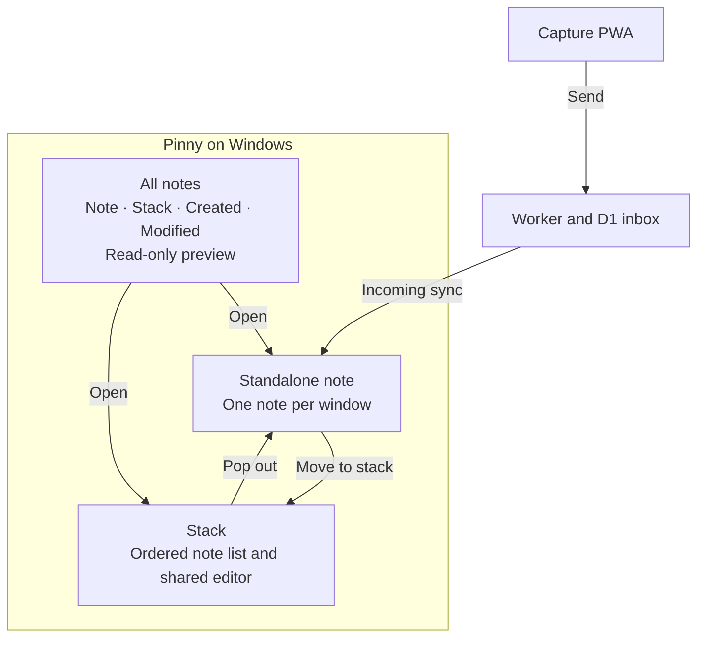
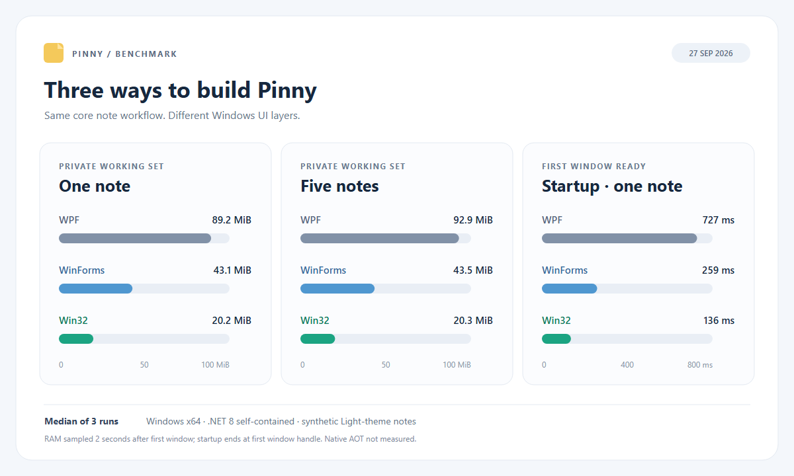

# Pinny

Pinny is a small Windows desktop notes app built with Go and direct Win32 calls. The current app uses local JSON files, with no database, web view, local server, or background service. The repository supports WSL-first development and Windows runtime verification.

`Pinny.Go/` is the active app; `cloud/` is the independent Cloudflare capture inbox and website. `Experiments/` contains frozen benchmark comparisons. Start with [development across operating systems](DEVELOPMENT.md), [technical notes](TECHNICAL.md), and [capture and sync](docs/SYNC.md).

## How Pinny fits together



## Use the app

On Windows x64, double-click `dist\Pinny.exe` after building it. The executable does not require a separate Go or .NET installation.

- Type directly into any note. Standalone notes have their own window. Notes in a stack share the stack window and keep their own text, title, and color.
- Hold **Ctrl** and click an `http://`, `https://`, or `www.` link to open it in your default browser. Normal clicks still edit text.
- Links have a subtle underline. Hover for a “Ctrl+click to open link” hint; hold Ctrl over the link to see a hand cursor.
- Choose **⋯ → Rename note...** to set a title. Press **Enter** to save or **Escape** to cancel. Standalone titles appear in the header and taskbar. In a stack, note titles appear in the list and the stack name appears in the header.
- Click **+** in a standalone window to create another standalone note nearby. In a stack, **+** adds a note to that stack.
- Drag a note's header to move it; drag an edge or corner to resize it.
- Click the diamond to toggle always-on-top for the current window.
- Choose **⋯ → Note color** for Light, Dark, Paper, Soft yellow, Peach, Rose, Mint, or Lavender. A checkmark shows the current color; each note remembers its own selection.
- Click **⋯** to browse all notes, manage stacks and Trash, import or export notes, or choose a notes folder.
- Click the red **×**, choose **⋯ → Quit Pinny (keep notes)**, or close any note window from the taskbar to exit while keeping every note.

### Browse all notes

Choose **⋯ → All notes...** to see standalone and stacked notes together. The
list shows **Note**, **Stack**, **Created**, and **Modified**, with the most
recently modified notes first. Select a row to read or copy its text in the
read-only preview on the right. Double-click the row or choose **Open note** to
edit it in its standalone window or stack.

Dates display in your Windows local time. Pinny updates **Modified** when you
edit the text or rename the note. Older notes and backups show **Unknown** for
dates they did not record.

### Group notes into stacks

1. On a standalone note, choose **⋯ → Stacks → Create stack from this note**.
   Use **Rename stack...** in the same menu to name it.
2. Add notes with **+** in the stack, or open a standalone note's **Stacks**
   menu and choose **Move to** followed by the stack name.
3. Select a note in the stack list to edit it. Drag its row or use the
   **↑ ↓** arrows in the stack header to change its saved position. **F6**
   switches focus between the list and editor. With the list focused,
   **Ctrl+↑** and **Ctrl+↓** also reorder the selected note.
4. Choose **⋯ → Stacks → Pop out this note** to give the selected note its own
   window. Use **Move back to** in that window's **Stacks** menu to return it
   to its saved position. **New standalone note** creates a separate note
   directly from a stack.

### Deleting and recovering notes

Choose **⋯ → Move this note to Trash** to remove one note. Pinny saves that note to `trash.json` before removing it from `notes.json`; it stays recoverable across restarts. If it was the last open note, Pinny exits and opens a blank note on the next launch. Choose **⋯ → View Trash...** to browse deleted notes, read their contents, restore a selected note, permanently delete one note, or empty all of Trash. The list shows the newest deletion first. Both permanent deletion actions ask for confirmation. **⋯ → Restore last deleted note** remains a shortcut for the newest note. Trash is never emptied automatically.

Restoring a note opens it in a standalone window. If it came from a stack, use
**⋯ → Stacks → Move back to** to return it.

Pinny saves open notes to `%LOCALAPPDATA%\Pinny\notes.json` and trashed notes
to `%LOCALAPPDATA%\Pinny\trash.json`. Changes save 500 ms after the last edit,
layout change, or stack change, and again when quitting. The Go app reads
notes saved by the earlier WPF version in the same folder. When upgrading
from the single-note version, Pinny loads the old `note.json` if
`notes.json` does not exist and keeps the original file as a backup. If a
saved position is off-screen after a monitor change, Pinny moves that
window back into view.

### Choose a notes folder

Choose **⋯ → Choose notes folder...** to pick a folder in the app. Pinny copies all current notes and Trash there, saves future changes there, and remembers the folder for future launches. The original files are kept. To protect another collection, the destination must not already contain `notes.json`, `trash.json`, or the older `note.json`. The choice is stored in `%LOCALAPPDATA%\Pinny\settings.json`.

You can also set the `PINNY_DATA_DIR` user environment variable or pass `--data-dir <folder>` for one launch. The selection order is command-line option, environment variable, remembered folder, then the default `%LOCALAPPDATA%\Pinny`. No `.env` file is required or read by the app.

In PowerShell, `$env:PINNY_DATA_DIR = 'C:\Notes\Pinny'` sets it for the current session. Then run `.\dist\Pinny.exe`.

Changing the environment variable or command-line option does not copy existing notes. Close Pinny and copy `notes.json` and `trash.json` to the new folder if you want to retain them, or use the folder picker in the app. Keep only one running app pointed at a notes folder: the current JSON storage does not merge simultaneous edits. The archived builds under `Experiments/` keep their own default folders and ignore `PINNY_DATA_DIR`.

### Export and import

Choose **⋯ → Export notes...** to save one readable JSON backup of your open
notes and Trash. It includes current edits, note titles and dates, window
settings, stack names and order, and saved stack return positions. The backup
has `Version`, `Notes`, and `Trash` fields. For a full move to another PC
with capture sync, see [sync recovery](docs/SYNC.md#local-representation-and-recovery).

Choose **⋯ → Import notes...** to add a backup to your current collection.
Conflicting note IDs get new IDs, and imported stacks open as separate groups
with their saved order. The importer also accepts a plain `notes.json` array
from earlier versions. Invalid files are rejected before changing the
collection. Imported window positions are moved into view if needed.

## Requirements

- **Run:** Windows 10 or 11, x64.
- **Development build:** Go 1.22 or newer and Bash in WSL/Linux/macOS, or Windows Go and PowerShell. Cross-builds target Windows x64.
- **Run desktop tests and package a release:** Windows, Windows Go, and PowerShell. The release script embeds the app icon using Windows APIs.
- **Build the frozen comparisons:** Windows and the relevant SDKs; .NET 8 for C#, Rust/Cargo for Rust. These are not needed to develop the active Go app.
- **Cloud/web:** Node 24 and npm; local Wrangler and D1 tooling are independent of desktop SDKs. See [cloud/README.md](cloud/README.md).

## Build from source

### WSL, Linux or macOS development

Keep editing and Git in your preferred environment. Install Go there, then run
from the repository root:

```bash
bash scripts/build-windows.sh
```

This produces `dist/Pinny.exe` without the embedded release icon. It does not run
Windows tests or provide a Linux/macOS desktop app. In WSL, when working in the
Windows-mounted checkout, launch it with `./dist/Pinny.exe` through Windows
interoperability. On Linux/macOS without Windows, use another
Windows machine for runtime checks.

See [development across operating systems](DEVELOPMENT.md) for checkout locations,
test boundaries, and future cloud/mobile development.

### Windows release and runtime checks

From the repository root in PowerShell, run:

```powershell
.\Build-Pinny.ps1
.\dist\Pinny.exe
```

This produces the Windows GUI executable `dist\Pinny.exe` with the Pinny icon. To build without the release script during development:

```powershell
Push-Location .\Pinny.Go
go run .
Pop-Location
```

Run desktop tests from the repository root in Windows PowerShell:

```powershell
go -C Pinny.Go test ./...
```

Run checks locally: portable sync tests and Windows cross-compilation on Linux,
Worker/local D1 tests independently, and desktop tests/release packaging on
Windows. Interactive UI smoke checks require a Windows desktop. GitHub Actions
workflows are intentionally disabled to avoid using GitHub compute.

`bin`, `obj`, and `dist` are ignored by Git. A GitHub source checkout will not contain the executable; attach it to a GitHub Release if you want others to download it without building.

## Project layout

- `Pinny.Go/main.go`: active Win32 note windows, controls, and save coordination.
- `Pinny.Go/notes_view.go`: All notes list, dates, and read-only preview.
- `Pinny.Go/stacks.go`: grouped windows, note switching, and ordering.
- `Pinny.Go/storage.go`: active JSON storage and single-note migration.
- `Pinny.Go/Pinny.ico`: active app icon.
- `Build-Pinny.ps1`: main Go release build with icon.
- `scripts/build-windows.sh`: development cross-build from Bash/WSL/Linux/macOS.
- `cloud/`: TypeScript Worker API, versioned D1 migrations and mobile-friendly website.
- `Pinny.Go/internal/capture/`: portable incoming-sync protocol and tests.
- `docs/SYNC.md`: API, desktop setup, delivery recovery and future client boundaries.
- `Experiments/Pinny.WpfBaseline/`, `Experiments/Pinny.WinForms/`, `Experiments/Pinny.Win32/`: three standalone source snapshots of the simple app.
- `Experiments/Pinny.Rust/` and `Experiments/Pinny.Go/`: frozen native Win32 comparisons; Rust is in-memory, while Go saves local JSON. See [build and benchmark commands](Benchmarks/README.md#rust-and-go-win32-experiments).
- `Experiments/Baseline/`: model and storage source shared only by those snapshots; see [experiment structure](Experiments/README.md).
- `Benchmarks/`: five-build comparison and scripts to build and measure the frozen experiments.
- `TECHNICAL.md`: architecture and current technical decisions.
- `DEVELOPMENT.md`: WSL-first workflow and development responsibilities by OS.

## Capture and sync

The optional capture PWA, Cloudflare Worker and D1 inbox send new notes and
todos to the Windows client. Configure the endpoint and desktop app credential using
**⋯ → Configure sync...** and a private JSON file; see [setup](docs/SYNC.md).
Unconfigured installations make no network requests.

**⋯ → Automatic sync** defaults on and checks at startup and every 15 minutes.
Uncheck it to disable both startup and scheduled sync. **Sync now** remains
available. Requests run while you edit. Each capture arrives as a standalone
note and appears in **All notes**. **Created** uses the time the Worker accepted
the submission. Todos become editable `[ ]`/`[x]` text notes. Sync is one-way
from the capture inbox to Windows. See [PWA setup and offline retry](cloud/README.md#install-and-capture-offline)
and [API and recovery](docs/SYNC.md).

## Performance experiments

The benchmark compares the five builds under `Experiments/`. It does not measure future changes to the active Go app under `Pinny.Go/`.



[Benchmark methods and results](Benchmarks/README.md) · [All 30 raw measurements](Benchmarks/results.csv)

With one synthetic note, median private working set was 103.2 MiB for C# WPF, 49.0 MiB for C# WinForms, 25.1 MiB for C# Win32, 6.3 MiB for Rust Win32, and 7.3 MiB for Go Win32. First-window startup was 780, 381, 136, 44, and 42 ms respectively. Rust keeps notes in memory; Go loads and saves the same JSON note format as the C# builds.

| Version | Interface | Note storage | Open after publishing |
| --- | --- | --- | --- |
| WPF baseline | Borderless WPF window | `%LOCALAPPDATA%\Pinny.Baseline\Wpf\notes.json` | `dist\baseline-2026-09-27\wpf\Pinny.exe` |
| WinForms baseline | Borderless Windows Forms window | `%LOCALAPPDATA%\Pinny.Baseline\WinForms\notes.json` | `dist\baseline-2026-09-27\winforms\Pinny.WinForms.exe` |
| Win32 baseline | Borderless note window with a painted header and native edit control | `%LOCALAPPDATA%\Pinny.Baseline\Win32\notes.json` | `dist\baseline-2026-09-27\win32\Pinny.Win32.exe` |
| Rust Win32 | Painted Win32 window and native edit control | None | `dist\native\Pinny.Rust.exe` |
| Go Win32 | Painted Win32 window and native edit control | `%LOCALAPPDATA%\Pinny.Go\notes.json` | `dist\native\Pinny.Go.exe` |

All three snapshots can open multiple notes, edit plain text, move and resize windows, pin individual notes, choose Light/Dark/Paper, delete individual notes, quit while retaining all notes, and restore saved notes. The Win32 version has a painted header with New, Menu, Pin, and Close controls and a native popup menu. Each snapshot has its own default data directory, separate from the active app. All support `--data-dir <folder>` for isolated testing.

Build the snapshots with the .NET 8 SDK on Windows:

```powershell
dotnet build .\Experiments\Pinny.WpfBaseline\Pinny.WpfBaseline.csproj -c Release
dotnet build .\Experiments\Pinny.WinForms\Pinny.WinForms.csproj -c Release
dotnet build .\Experiments\Pinny.Win32\Pinny.Win32.csproj -c Release
```

Publish all three self-contained executables from the repository root:

```powershell
.\Benchmarks\Publish-Baseline.ps1
```

To build and measure all five implementations in PowerShell:

```powershell
.\Benchmarks\Publish-Baseline.ps1
.\Benchmarks\Build-Native.ps1
.\Benchmarks\Measure-Pinny.ps1
```

To smoke-test the WinForms, C# Win32, and frozen Go versions with synthetic notes (edit, move, resize, pin, restart, create and delete a note):

```powershell
.\Benchmarks\Smoke-Persistence.ps1
```

To check the active Go app's save, Trash, restore, and safe-close behavior using isolated test data:

```powershell
.\Benchmarks\Smoke-Persistence.ps1 -Variants active-go
```

To check native picker cancellation and startup from a remembered folder, then exercise JSON transfers and failure recovery with live note windows and isolated test data:

```powershell
.\Benchmarks\Smoke-Transfer.ps1
Push-Location .\Pinny.Go
go test ./...
Pop-Location
```

The benchmark script uses synthetic notes and updates the single tracked CSV and chart under `Benchmarks/`. Published executables and temporary synthetic folders are ignored by Git. Native AOT was not measured because the required C++ linker is not installed on this machine.
